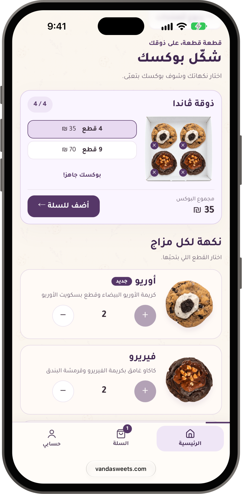
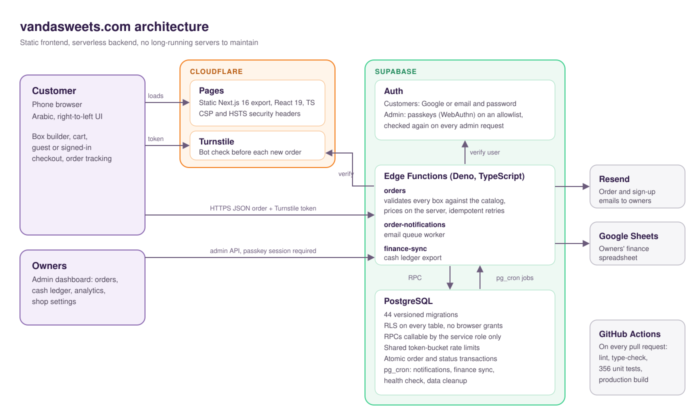

# Vanda: ordering platform for a family bakery

<p align="center">
  
</p>

<p align="center">
  <a href="https://vandasweets.com"><b>vandasweets.com</b></a> · live since October 2026 · designed, built and run by <a href="https://www.linkedin.com/in/amru-alyan-b84038335/">Amru Alyan</a>
</p>

> The source code is private because the site runs a real business and stores real customer orders.
> This repository explains what I built and how. I'm happy to walk through the code in an interview.

## What it is

[Vanda Cookies & Sweets](https://vandasweets.com) is a family business in Jerusalem that I co-founded with my sister. She runs daily operations; I built the platform the business takes orders through.

vandasweets.com is an Arabic, right-to-left, mobile-first ordering site. Customers build their own cookie boxes piece by piece, check out as guests or with an account, and follow their orders. The owners run everything from an admin dashboard on their phones.

## Features

**For customers**
- Visual box builder: pick flavours and watch the box fill up, with live pricing
- Persistent cart, guest or signed-in checkout (Google, or email and password)
- Pickup or delivery, order tracking, and a loyalty gift on every third order
- Right-to-left UI with animations that respect reduced-motion settings

**For the owners**
- Admin dashboard: order search and filters, status changes with full history, cash ledger, analytics
- Shop settings without a deploy: flavour and box availability, discounts, gift options
- Email alerts for new orders and new accounts
- Finance data synced to the owners' Google Sheet
- Passkey (WebAuthn) sign-in for the admin area

## Screenshots

Taken on an iPhone 18 Pro Max (iOS Simulator) from the live site.

| Home | Box builder | Added to cart | Cart | Account |
|:---:|:---:|:---:|:---:|:---:|
|  |  |  |  |  |

## Architecture

<p align="center">
  
</p>

- **Frontend:** Next.js 16 and React 19 in TypeScript, exported as a static site and served by Cloudflare Pages with strict security headers (CSP, HSTS).
- **Backend:** Supabase. Three Edge Functions (Deno, TypeScript) hold all business logic: `orders` (checkout, accounts, admin API), `order-notifications` (email queue worker) and `finance-sync`.
- **Database:** PostgreSQL, evolved through 44 versioned migrations. Scheduled jobs run with `pg_cron`.
- **No servers to babysit:** everything is static hosting or serverless, which keeps a small business's running costs close to zero.

## Engineering highlights

### The server is the source of truth for prices

The browser shows prices, but never decides them. Every order is validated against the catalog on the server, priced there, and refused if the total the customer saw no longer matches.

```ts
// lib/order-validation.ts (abridged)
export function validateOrder(value: unknown, catalog: OrderCatalog, settings: ShopSettings, now = new Date()) {
  // ...
  const items = data.items.map((raw) => {
    const product = catalog.products.find((p) => p.id === line.productId);
    if (!product) throw new Error("منتج غير متاح."); // "Product unavailable."
    const quantity = integer(line.quantity, 1, 20);
    // A scheduled flavour is refused until its release instant (server clock).
    // ...
    const unitPrice =
      product.price_minor + Math.max(0, sauces - 1) * catalog.extra_sauce_price_minor;
    return { productId: product.id, quantity, unitPrice /* ... */ };
  });
  // The discount in force now (end date included), never the one the browser claims.
  const percent = activeDiscountPercent(settings, now);
  const { subtotal, discount, total } = orderPricing(items, percent, fulfillment.fee);
  if (data.expectedTotal !== total) throw new OrderPriceChanged(/* ... */);
  // ...
}
```

### Deny-by-default database

Row Level Security is on for every table and the browser roles get no grants at all. Only server code, through a small set of database functions, can read or write orders.

```sql
-- supabase/migrations/20260917204938_orders_backend.sql (abridged)
alter table public.vanda_orders enable row level security;
revoke all on public.vanda_admins, public.vanda_orders, public.vanda_order_events from anon, authenticated;
grant all on public.vanda_admins, public.vanda_orders, public.vanda_order_events to service_role;

revoke all on function public.vanda_create_order(uuid,text,text,text,text,jsonb,integer) from public, anon, authenticated;
grant execute on function public.vanda_create_order(uuid,text,text,text,text,jsonb,integer) to service_role;
```

### Protection against abuse and double orders

- **Bot check:** every new order needs a Cloudflare Turnstile token, verified on the server before anything is saved.
- **Rate limits:** token buckets stored in PostgreSQL, shared by all Edge Function instances. They key on hashed (HMAC) identifiers, so raw phone numbers, emails and IP addresses are never stored for this.
- **Idempotent checkout:** each checkout attempt carries a random key. A retry after a network error returns the original receipt instead of creating a second order.
- **Bounded input:** request bodies are size-limited before parsing, and every field is validated.

### A locked admin area

Admin routes check, on every request, a confirmed email on an allowlist and a session that started with an approved passkey. Status changes run in a single transaction with an expected-state check, so two people working at once can't silently overwrite each other, and every change lands in an audit trail.

### Tested and reviewed before it ships

- 356 unit tests, run with lint, type-checking and a production build by GitHub Actions on every pull request
- Load, stress, spike and soak tests before launch
- Every change goes through a pull request and a preview deployment, then the owners approve it before production

## Tech stack

| Area | Tools |
|---|---|
| Frontend | Next.js 16 (static export), React 19, TypeScript |
| Backend | Supabase Edge Functions (Deno), PostgreSQL, Supabase Auth |
| Auth | Google OAuth, email and password, passkeys (WebAuthn) |
| Hosting and security | Cloudflare Pages, Turnstile, DNS |
| Email | Resend |
| Integrations | Google Sheets API |
| Quality | Node test runner, ESLint, GitHub Actions |

## How I work

I build with AI coding agents (Claude Code, Codex) and stay responsible for the design, the review and the testing of everything that ships. Decisions, QA notes and deploy records are written down in the private repository as the project goes.

## About me

I'm Amru Alyan, a software engineering graduate (B.Sc., Azrieli College of Engineering, Jerusalem) looking for a junior software engineer or full-stack role.

[LinkedIn](https://www.linkedin.com/in/amru-alyan-b84038335/) · [GitHub](https://github.com/AmruAlyan)

---

The Vanda name, logo, product photos and screenshots belong to Vanda Cookies & Sweets. No license is granted for them.
